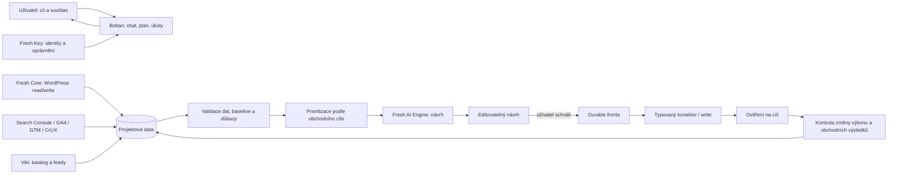

# BOBAN — technická architektura, datové kontrakty a workflow

**Stav:** cílový kontrakt + potvrzené části v kódu. Jednotlivá implementace v `main`/PR není automaticky provozně otestovaná.  
**Reference:** `architecture.md`, `integrations.md`, `roadmap-0.7x-0.8.md`, `app.py`, `manage.py`, `advisor_intelligence.py`, `commerce_analytics.py`, PR #1–#7.

## 1. Logické schéma

Aplikace v repozitáři je Flask/Python + Jinja/JS + MariaDB/MySQL (SQLite jako alternativní režim), hostovaná Passenger/cPanel. `app.py` aktuálně přesahuje 10 tisíc řádků; architektura má postupně oddělit odpovědnosti, nikoliv přepsat vše naráz.

## 2. Komponenty a zdroj pravdy

| Vrstva | Současný výchozí kód | Cílová zodpovědnost |
|---|---|---|
| Web/chat/účty/UI | `app.py`, `templates/`, `static/` | Předání cíle, dialog, schválení, evidence aktuální práce |
| Projekty, role | `projects`, `project_members`, Fresh Key wrapper | Projekt, vlastník, editor/správce, explicitní oprávnění |
| Zdroje a snapshoty | `source_snapshots`, integrace, `sync_reporting.py` | Čerstvost dat, poslední úspěšné načtení, chyba a identita zdroje |
| Analytika a cíle | `business_dashboard.py`, `commerce_analytics.py`, `advisor_intelligence.py` | Ověřené objednávky, poptávky, konverze; neodhadovat nulu |
| SEO audit a plán | `app.py`, `advisor_goal_actions.py`; `goal_first.py` jen PR #1 | Návrhy s důvodem, obchodní prioritou, zdrojem důkazu |
| Schvalované akce | `actions`, `action_revisions`, `issues` (interní Boban nálezy) | Jednoznačná verze návrhu a rozhodnutí uživatele |
| Fronta | `jobs`, `manage.py` | Bezpečný claim, retry/lock, heartbeat, ověření, lidský výsledek |
| Monitoring UI | `worker_state`; `job_monitor.py` jen PR #4/#7 | Co, proč, od kdy, kdo schválil, stav, blocker, důkaz, ETA |
| Katalogové exporty | `feed_workflow.py`, `merchant_export.py`, `heureka_export.py`, `zbozi_export.py`, `meta_export.py`; Pinterest jen PR #6/#7 | Dočasná infrastruktura → vlastnictví Viki po migraci |
| AI | `call_fresh_ai_engine`, `engine_runs` | Modelové požadavky, náklad, stav, kvalita; neplést s exekucí |

**Pozor:** slovo `issues` v aplikaci znamená SEO nálezy; GitHub Issues znamenají vývojové úkoly. Tyto dvě evidence se nesmějí zaměňovat.

## 3. Workflow jednoho úkolu

`zdroj → vyhodnocení → konkrétní návrh → uživatelská editace → schválení → fronta → bezpečný zápis → nezávislé ověření → měření dopadu → další rozhodnutí`

### Minimální životní cyklus
1. **Detected:** zdroj a datum nálezu; důkaz / nedostatek důkazu.
2. **Proposed:** co změním, proč, co očekávám, cílový objekt a zdroj.
3. **Needs approval:** viditelná změna „před/po“, správný projekt a oprávnění.
4. **Queued:** úloha je v DB, není ještě potvrzený start.
5. **Running:** převzal ji skutečný worker (platný heartbeat k **této úloze**).
6. **Write accepted:** cílové API hlásí přijetí, ale dokončení ještě není ověřeno.
7. **Verified / Failed / Blocked:** nezávislý důkaz, nebo konkrétní chybný důvod. Stavy musí být rozlišeny.
8. **Impact pending / measured:** GSC/GA4/objednávky/poptávky po dostatečném intervalu; nikdy neprohlašovat za okamžitý obchodní úspěch.

### Bezpečnost
- Pouze výslovně povolené operace `provider + operation`; žádný volný SQL/PHP/REST zápis z chatu.
- Cizí doména, chybějící/nejednoznačné WP ID → terminální chyba; nepřepisovat podobný produkt.
- Timeout zápisu znamená „nejistý výsledek“: nejdřív ověřit, až potom případně opakovat.
- Schválení platí pro konkrétní revizi návrhu, po změně je potřeba nové.
- Nepřepisovat uživatelská data při release; tajné klíče a `.env` pouze server/vault.

## 4. Oddělení procesů (návrh v PR #2/#3/#7)

| Proces | Navržený plán | Ověřitelnost |
|---|---|---|
| `work-queue` | Každou minutu, zámek a malé dávky | Started/heartbeat/finished konkrétních jobů |
| `daily-sync` | Kontrola 5 min, denní úspěšné načtení od 05:00 Europe/Prague | Last success per project/provider/day |
| `connector-heartbeat` | Každých 15 min, malý read-only probe | Ověřený přístup ≠ uložený OAuth |
| `boban-cycle` | Každých 15 min prověřit splatnost automatického plánu | Počet vytvořených návrhů a důvody vynechání |
| Katalogový sync | Stávající oddělený tok, Viki cílový vlastník | Pokrok po dávkách, poslední úplná revize, feed status |

**Konflikt vydání:** `release-0.9.13.24.md` říká nechat SEO cron vypnutý do vyšetření zápisů. PR #2/#7 připravují nové automatické crony. Dokud se neověří bezpečný produkční zápis i rollback, automatické publikování nemá být bezpodmínečně zapnuté. Read-only syncy lze posuzovat odděleně.

### Provozně čitelný worker
Uživatel vidí název úkolu, důvod, aktuální fázi, zařazeno/spuštěno/poslední aktivitu/dokončeno, chybu a další krok; pouze při dostatku pozorování podložený čas dokončení. Technické fronty a logy patří do admin diagnostiky.

## 5. Kontrakty konektorů

Každý provider přizná:
- **configured** (uložené připojení), **reachable** (poslední reálný probe), **synchronized** (poslední dokončená data), **write_allowed** (konkrétní oprávnění), **execution_result** (ověřený konkrétní zápis);
- `last_attempt`, `last_success`, `error_type`, `source_period`, `credential_ref` bez zveřejňování tajemství;
- vymezený read/write scope, limity API, retry a mapování chyby.

Fresh Core: WordPress metadata, produkty a SEO objekty. GSC: výkon, URL inspection, sitemap. GA4: návštěvnost/události/konverze. GTM: kontrola tagů. CrUX/PageSpeed: výkon. Merchant/feed: validace a obchodní stav, ne přepis skladů.

## 6. Měření obchodního výsledku

Evidence: `baseline`, `period_start/end`, `metric_name`, `source`, `confidence`, `last_verified`, `observed_change`, `business_outcome`, `attribution_limits`.

- SEO: indikace kliknutí/CTR/pozic a návštěv na změněné landing page.
- E-shop: objednávky, tržby, konverzní poměr a zdroj; potvrzené z Woo/GA4, ne odhad z „key events“.
- B2B: kvalifikované leady a hodnota podle definice zákazníka.
- PPC: náklad, konverze, CPA/ROAS až po správně zavedeném měření.
- Ztráta dat nebo chybějící integrace = explicitní `unknown`.

## 7. Deploy a provedení změny

`GitHub Issue → schválený rozsah → branch → PR → CI → review → staging/smoke → merge main → deploy → otisk běžící verze → produkční smoke → výsledek Issue`.

**V GitHubu hotový kód ≠ produkčně hotová funkce.** GitHub Desktop `Fetch/Pull` mění lokální pracovní kopii, nikoli Exon. Produkční manifest a otisky souborů musí být odděleny od údajů v repozitáři.

## 8. Technický dluh

- Monolitický `app.py`: postupně extrahovat moduly při dotčených změnách, bez velkého souběžného refaktoringu.
- Runtime artefakty v git historii / `generated_feeds` / `sync_locks`: potřebují jasné oddělení a audit možných veřejných feed URL/tokenů.
- Historické README a release soubory obsahují neplatné či zastaralé příklady cronu; vytvořit jeden aktuální provozní návod a označit staré jako archiv.
- Jednotné integrační/e2e testy a produkční důkazy zatím nejsou doloženy.
